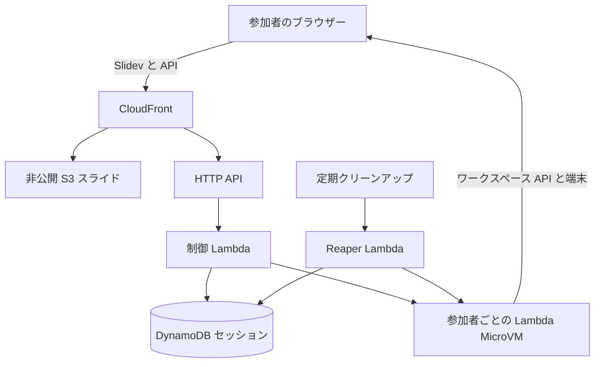

# ExecDeck

[English](README.md)

**Slidev のスライドを、手を動かせるコーディングワークショップにします。** 発表スライドと、ブラウザー上のファイルツリー・エディター・実ターミナルを一つにまとめます。ローカルでは Docker で起動し、AWS では参加者ごとに分離した Lambda MicroVM を使って公開できます。

## 主な機能

- Slidev の標準テーマを使ったスライドとワークショップ用レイアウト。
- VS Code のようなファイルツリー、Monaco エディター、xterm ターミナル。
- スライドごとに切り替えられる統合・エディターのみ・ターミナルのみ・非表示モード。
- ワークベンチの高さ、ツリーの幅、エディターとターミナルの割合を設定可能。
- Docker でローカル起動。AWS では参加者ごとに Lambda MicroVM を起動。
- `terraform apply` 一度で MicroVM イメージの作成から公開まで実行。
- ワークショップ作成を支援する Codex スキルを同梱。

## ローカルで起動する

Docker Engine または Docker Desktop と Compose が必要です。

```sh
git clone https://github.com/mu7889yoon/execdeck.git
cd execdeck
docker compose up --build
```

[http://localhost:3030](http://localhost:3030) を開いて **Hello, World!** のスライドまで進み、**Start workspace** を選びます。`hello.sh` を開いて、ターミナルで次を実行します。

```sh
bash hello.sh
```

ターミナルは sandbox コンテナ内で動きます。ワークスペースは Docker の名前付きボリュームに保存され、再起動後も残ります。初期状態に戻すには次を実行します。

```sh
docker compose down --volumes
```

ローカルモードは信頼できる参加者向けです。公開するポートは `127.0.0.1` に限定した Slidev のポートだけです。

## AWS にデプロイする

Terraform が `microvm/Dockerfile` から MicroVM ランタイムをビルドし、Slidev サイト、API、セッション終了処理を一度の apply でデプロイします。

必要なもの:

- Terraform `>= 1.9`。
- Terraform を実行するマシンで利用可能な Docker。
- `infra/` のリソースを作成し、Lambda に MicroVM ビルドロールを渡せる AWS 認証情報。
- Lambda MicroVM が利用できる AWS リージョン。初期値は `ap-northeast-1` です。

```sh
cd infra
terraform init
terraform apply
```

Terraform は Node 24 のビルドコンテナで Slidev と Lambda パッケージを作成し、MicroVM 用 ZIP をアップロードしてイメージのビルド完了を待ちます。完了後に表示される `workshop_url` を開いてください。

不要になったら、同じディレクトリと変数を使ってリソースを削除します。

```sh
terraform destroy
```

## ワークショップを作る

1. `slides/slides.md` を Slidev Markdown で編集します。テーマは Slidev の標準テーマです。
2. 参加者が編集・実行するファイルを `microvm/workspace/` に置きます。
3. スライド単位で表示モードを指定します。

   ```md
   ---
   layout: workshop
   workbench: integrated
   ---
   ```

   `workbench` は `integrated`、`editor`、`terminal`、`hidden` から選べます。省略すると設定の既定モードになります。

4. `slides/workshop.config.json` で割合を調整します。

   ```json
   {
     "defaultMode": "integrated",
     "layout": {
       "workbenchHeight": 50,
       "explorerWidth": 22,
       "editorHeight": 60
     }
   }
   ```

   数値はパーセントです。ワークベンチの高さはスライド全体、ツリーの幅はワークベンチ、エディターの高さは右側ペインを基準にします。

参加者のファイルツリーは既定で `/workspace` をルートにします。特殊なランタイムでは Terraform に `-var='workspace_root=/workshop'` を渡してください。ローカル Docker では `EXECDECK_WORKSPACE_ROOT=/workshop docker compose up --build` とします。選択したワークスペースが空の場合、起動時に初期ファイルをコピーします。

ローカル起動時は `slides/` をコンテナへマウントするため、Markdown やレイアウトの変更が開発サーバーに反映されます。AWS の参加者用ワークスペースに含めるファイルを変更したら、`terraform apply` を再実行してイメージを更新してください。

## 構成



制御プレーンは HTTP 専用 Cookie でブラウザーと MicroVM を対応付けます。ファイルとターミナルの通信には、ポートを限定した短時間の認証トークンを使います。参加者はワークベンチの **Stop** で環境を終了でき、定期処理も期限切れの環境を削除します。

ローカルモードでは Docker Compose が Slidev、ワークスペース API、PTY ターミナルを別々のコンテナで起動します。ローカル起動に AWS 認証情報や Terraform は不要です。

## リソースと削除

クラウドでは参加者ごとに MicroVM が起動します。初期値では同時に最大 30 セッション、各セッションは最大 1 時間です。イベントに合わせて `infra/variables.tf` の `max_sessions` と `session_ttl_seconds` を調整してください。終了時は **Stop** を使い、時間切れの場合は定期クリーンアップが終了処理を行います。

Lambda MicroVM、制御 Lambda、イメージビルド、CloudFront、S3、DynamoDB、API Gateway、CloudWatch Logs などの AWS 利用料が発生する場合があります。公開前に AWS の料金とアカウントクォータを確認してください。`terraform destroy` は AWS のスタックを削除します。ローカルの Docker ワークスペースは `docker compose down --volumes` で削除します。

AWS スタックを削除する前に、参加者へ **Stop** を選ぶよう案内してください。使われなくなった環境も、最大実行時間と定期クリーンアップで終了します。

## セキュリティ

- クラウドのワークショップ URL は初期状態では公開です。URL を知っている人は、`max_sessions` の範囲で環境を起動できます。
- 参加者コードは Lambda MicroVM 内で実行され、初期設定では外向き通信を許可しません。
- CloudFront の標準ホスト名は AWS の既定 TLS ポリシーを使います。より新しい TLS ポリシーが必要な場合は、`us-east-1` の ACM 証明書を使う独自ドメインを設定してください。
- ローカルモードは信頼できる参加者向けです。Docker ホストやプレビュー用ポートを信頼できないネットワークに公開しないでください。
- ワークショップのファイルに認証情報や個人データを入れないでください。参加者環境は破棄可能なものとして扱ってください。
- 脆弱性の報告方法は [SECURITY.md](SECURITY.md) を参照してください。

## コントリビュートとライセンス

不具合報告、ドキュメント修正、機能提案を歓迎します。PR の前に [CONTRIBUTING.md](CONTRIBUTING.md) を確認してください。コミュニティには [行動規範](CODE_OF_CONDUCT.md) が適用されます。

ExecDeck は [MIT License](LICENSE) で公開します。

## 参考資料

- [AWS Lambda MicroVM イメージ](https://docs.aws.amazon.com/lambda/latest/dg/microvms-images.html)
- [Terraform `aws_lambdamicrovms_image`](https://registry.terraform.io/providers/hashicorp/aws/latest/docs/resources/lambdamicrovms_image)
- [Terraform `aws_lambdamicrovms_microvm`](https://registry.terraform.io/providers/hashicorp/aws/latest/docs/resources/lambdamicrovms_microvm)
