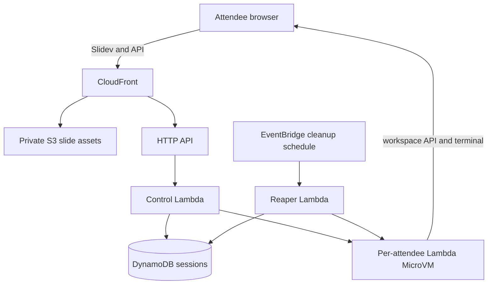

# ExecDeck

[日本語](README.ja.md)

**Turn Slidev slides into hands-on coding workshops.** ExecDeck pairs a presentation with a browser-based editor, file explorer, and real terminal. Run a workshop locally with Docker or deploy isolated AWS Lambda MicroVM workspaces for attendees.

[](LICENSE)
[](https://sli.dev/)
[](https://docs.aws.amazon.com/lambda/latest/dg/microvms.html)

## Features

- Slidev presentations with its default theme and a reusable workshop layout.
- A VS Code-inspired workbench: file tree, Monaco editor, and xterm terminal.
- Integrated, editor-only, terminal-only, and hidden modes, selectable per slide.
- Adjustable workbench height, explorer width, and editor-to-terminal split.
- Local preview and terminal in Docker; cloud attendees get isolated MicroVMs.
- One `terraform apply` builds the MicroVM image and deploys the workshop site.
- A bundled Codex skill for drafting and updating workshops.

## Quick start: local Docker

Requirements: Docker Engine or Docker Desktop with Compose support.

```sh
git clone https://github.com/mu7889yoon/execdeck.git
cd execdeck
docker compose up --build
```

Open [http://localhost:3030](http://localhost:3030), advance to the **Hello, World!** slide, select **Start workspace**, open `hello.sh`, and run:

```sh
bash hello.sh
```

The local terminal runs inside the sandbox container. The workspace lives in a named Docker volume and persists across restarts. Remove it to reset the example:

```sh
docker compose down --volumes
```

Local mode is for trusted, local workshops. Only the Slidev port is published, bound to `127.0.0.1`.

## Deploy to AWS

The cloud setup builds the MicroVM runtime from `microvm/Dockerfile`, deploys the Slidev site, and provisions the API and session cleanup resources in one Terraform apply.

Requirements:

- Terraform `>= 1.9`.
- Docker available to the machine running Terraform.
- AWS credentials with permissions to create the resources in `infra/` and pass the MicroVM build role to Lambda.
- An AWS Region where Lambda MicroVMs are available. The default is `ap-northeast-1`.

```sh
cd infra
terraform init
terraform apply
```

Terraform runs the Node 24 build container, builds the Slidev site and Lambda package, uploads the MicroVM artifact, and waits for the image build. When apply completes, open the `workshop_url` output.

Tear down the workshop and its Terraform-managed resources when they are no longer needed:

```sh
terraform destroy
```

Use the same working directory and variable values for `terraform destroy` that you used for `terraform apply`.

## Build a workshop

1. Edit `slides/slides.md` using Slidev Markdown and the default theme.
2. Put files attendees will edit or run in `microvm/workspace/`.
3. Set the workbench mode on a slide:

   ```md
   ---
   layout: workshop
   workbench: integrated
   ---
   ```

   Available modes are `integrated`, `editor`, `terminal`, and `hidden`. The `workbench` field may be omitted to use the configured default.

4. Tune `slides/workshop.config.json`:

   ```json
   {
     "defaultMode": "integrated",
     "layout": {
       "workbenchHeight": 50,
       "explorerWidth": 22,
       "editorHeight": 60
     }
   }
   ```

   Values are percentages: workbench height relative to the slide, explorer width relative to the workbench, and editor height relative to the right pane.

The participant file tree starts at `/workspace` by default. For a specialized runtime, pass `-var='workspace_root=/workshop'` to Terraform. For local Docker, set `EXECDECK_WORKSPACE_ROOT=/workshop` before `docker compose up --build`; the starter files are copied into the selected workspace when it is empty.

For local work, the `slides/` directory is bind-mounted into the Slidev container, so Markdown and layout edits appear through the dev server. Files to include in each newly created cloud MicroVM belong in `microvm/workspace/`; changing them requires another `terraform apply` so Terraform can build a new image.

## Architecture



The control plane uses an HTTP-only session cookie to associate a browser with its MicroVM. Workspace files and terminal traffic are sent through short-lived, port-scoped MicroVM auth tokens. A scheduled reaper terminates expired sessions; attendees can also stop their workspace from the workbench.

In local mode, Docker Compose runs Slidev and the same workspace API plus a PTY terminal in separate containers. No AWS credentials or Terraform are needed for the local preview.

## Repository layout

| Path | Purpose |
| --- | --- |
| `slides/slides.md` | Slidev presentation |
| `slides/global-bottom.vue` | File tree, editor, terminal, and session controls |
| `slides/workshop.config.json` | Workbench mode and split proportions |
| `microvm/workspace/` | Files included in each attendee workspace |
| `microvm/` | Local sandbox and Lambda MicroVM runtime |
| `control/` | AWS session API and cleanup handlers |
| `infra/` | Terraform deployment |
| `.agents/skills/execdeck-workshop/` | Bundled Codex workshop authoring skill |

## Resource usage and cleanup

Each cloud attendee can start a separate MicroVM. The default limit is 30 concurrent sessions and the default lifetime is one hour. Adjust `max_sessions` and `session_ttl_seconds` in `infra/variables.tf` for your event. Attendees should use **Stop** when they finish; the scheduled cleanup also handles sessions that reach their time limit.

AWS charges may apply for Lambda MicroVM usage, Lambda control functions, image builds, CloudFront, S3, DynamoDB, API Gateway, and CloudWatch Logs. Review AWS pricing and your account quotas before sharing a public workshop URL. `terraform destroy` removes the stack; the local Docker workspace is separate and is removed with `docker compose down --volumes`.

Ask attendees to select **Stop** before teardown so their MicroVMs are terminated promptly. Abandoned sessions are also bounded by the configured maximum duration and cleanup schedule.

## Security notes

- Cloud workshop URLs are public by default; anyone with the URL can request a workspace, subject to `max_sessions`.
- Attendee code runs in isolated Lambda MicroVMs with no configured egress connector by default.
- The CloudFront default hostname uses AWS's default viewer TLS policy. Use a custom domain and ACM certificate in `us-east-1` when your workshop requires a stricter TLS policy.
- The local mode is designed for trusted local use. Do not expose its Docker host or preview port to an untrusted network.
- Do not put credentials or private data in workshop files. Treat attendee workspaces as disposable.
- Report suspected vulnerabilities privately; see [SECURITY.md](SECURITY.md).

## Contributing

Bug reports, documentation fixes, and feature proposals are welcome. Read [CONTRIBUTING.md](CONTRIBUTING.md) before opening a pull request. Community participation follows the [Code of Conduct](CODE_OF_CONDUCT.md).

## License

ExecDeck is available under the [MIT License](LICENSE).

## References

- [AWS Lambda MicroVM images](https://docs.aws.amazon.com/lambda/latest/dg/microvms-images.html)
- [Terraform `aws_lambdamicrovms_image`](https://registry.terraform.io/providers/hashicorp/aws/latest/docs/resources/lambdamicrovms_image)
- [Terraform `aws_lambdamicrovms_microvm`](https://registry.terraform.io/providers/hashicorp/aws/latest/docs/resources/lambdamicrovms_microvm)
